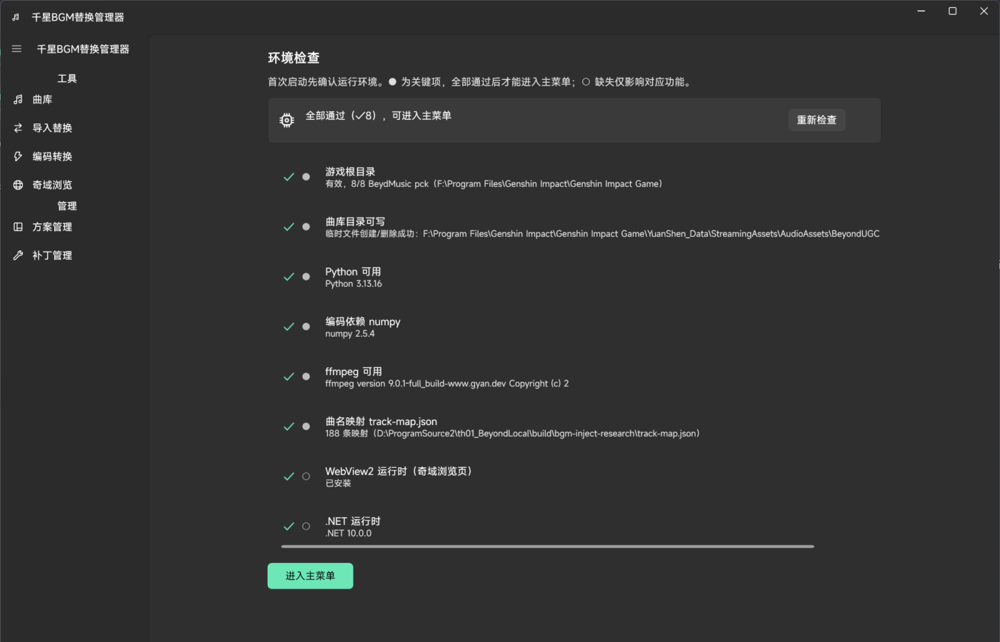
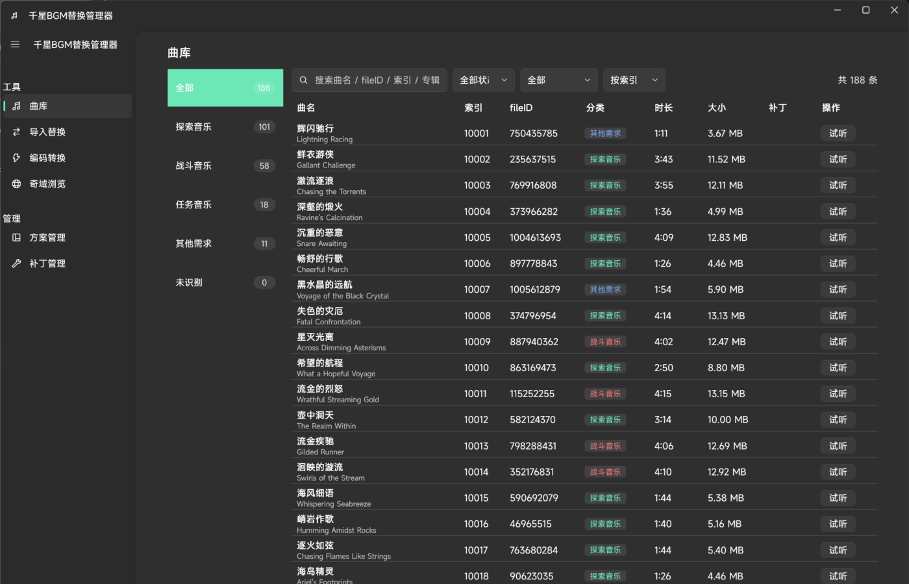
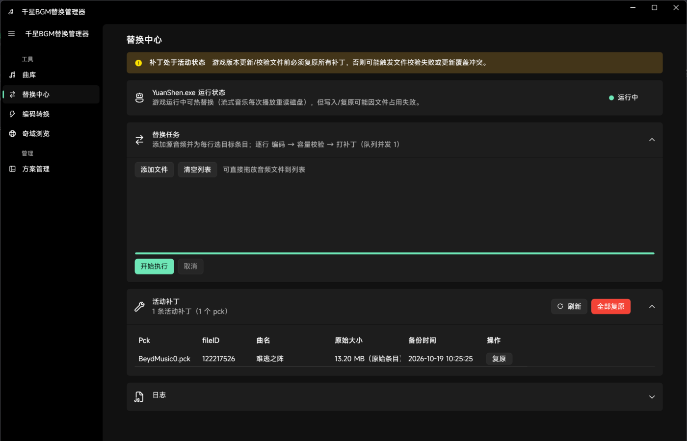
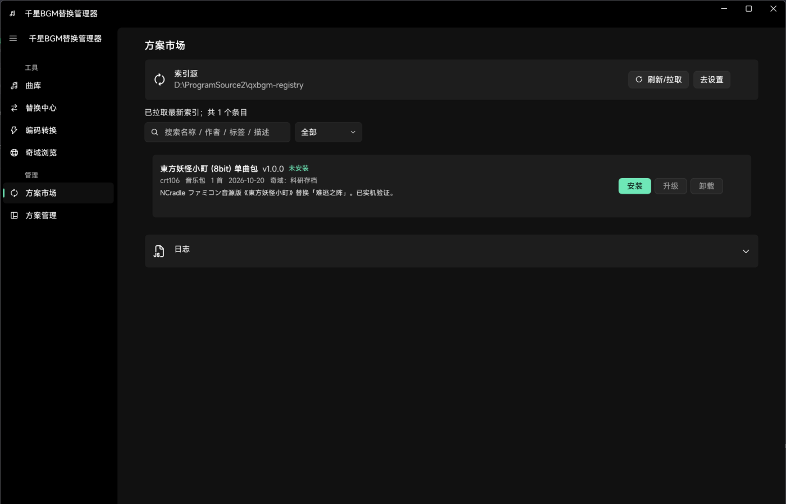

<div align="center">

# 🎵 QxBgmManager — 千星BGM替换管理器

**在原神·千星奇域中播放你自己的音乐。**
本地资产替换 · 一键安装方案 · 方案市场订阅 · PTADPCM 编解码

[]()
[]()
[]()
[](LICENSE)
[](https://github.com/crt106/qxbgm-registry/pulls)

</div>

---

## ⚠️ 重要声明（请先读）

本工具通过**替换本地客户端音频资产**工作，违反米哈游用户协议的可能性客观存在。
请在**测试小号**上使用，与正式账号隔离；补丁状态下不要更新游戏（先复原）。
本项目仅供技术研究学习，一切后果由使用者自负。替换只影响本机客户端，联机其他玩家不可见。

## ✨ 功能

| 页面 | 能力 |
|---|---|
| 🔍 **环境检查** | 首次启动逐项体检：游戏目录 / Python / numpy / ffmpeg / 曲名映射 / WebView2 |
| 🎼 **曲库** | 官方 188 轨全量浏览：分类、搜索、筛选、排序、**离线试听**；按可见区域渲染，切换分类复用视图 |
| 🔄 **替换中心** | 单条或批量"编码 → 容量校验 → 打入补丁"，支持热替换（游戏运行中生效） |
| 🛠️ **编码转换** | 任意音频 ↔ PTADPCM wem 互转、pck 条目抽取；显示百分比、耗时与预计剩余时间，支持取消 |
| 🛒 **方案市场** | 订阅索引仓库，一键安装/升级/卸载他人分享的 BGM 方案 |
| 📦 **方案管理** | 导入/导出 `.qxbgmzip` 方案包，本地安装登记与卸载 |
| 🌐 **奇域浏览** | 内嵌浏览器 + 奇域档案登记（为"按奇域 ID 关联方案"储备） |

## 📸 预览

<div align="center">
 
 
</div>

## 🚀 快速开始

### 使用者

1. 从 [Releases](https://github.com/crt106/QxBgmManager/releases) 下载 `QxBgmManager.exe`（自包含单文件，免安装）。
2. 首次启动完成环境检查（需要：原神客户端、Python 3.10+、ffmpeg）。
3. 设置页配置游戏根目录与 ffmpeg；方案市场默认索引源即 [qxbgm-registry](https://github.com/crt106/qxbgm-registry)。

### 开发者

```powershell
git clone https://github.com/crt106/QxBgmManager.git
cd QxBgmManager
powershell -ExecutionPolicy Bypass -File scripts\setup.ps1   # 便携 .NET SDK + numpy
vendor\dotnet\dotnet.exe build app\QxBgmManager.sln          # 构建
vendor\dotnet\dotnet.exe run --project app\Tests\SchemeTests # 方案、备份与转码自测
python app\Tests\codec_regression.py                        # 编码字节一致性、解码一致性与速度对照
vendor\dotnet\dotnet.exe run --project app\Tests\UiTests     # WPF 布局、滚轮与页面进度检查
```

基础自测自行生成静音 WEM 和音频，不依赖研究目录里的音乐文件。真实转码检查需要配置 Python、NumPy 和 ffmpeg；曲库窗口检查需要有效的游戏路径，缺少对应环境时会明确输出 `SKIP`。窗口检查会创建临时测试窗口，备份与恢复测试使用合成 PCK，均不修改游戏音乐包。截图及编码速度报告输出到 `build/verification/`，不入库。

自包含单文件发布：

```powershell
vendor\dotnet\dotnet.exe publish app\QxBgmManager.csproj -c Release -r win-x64 --self-contained true -p:PublishSingleFile=true -p:IncludeNativeLibrariesForSelfExtract=true -o app\publish
```

本次修复了导航容器导致的全量布局、矮窗口滚动和内层列表的滚轮传递，并精简界面文案。编码改为独立帧批量计算，保留 beam64 参数；24000 个合成单声道采样的编码核心对照约快 2.5 倍，输出逐字节一致，实际整曲耗时取决于机器与音频长度。

## 🧠 技术原理（简述）

- 千星奇域音乐库位于客户端 `AudioAssets/BeyondUGC/BeydMusic0-7.pck`（Wwise AKPK 容器，共 188 轨）。
- 本工具自研 **PTADPCM**（Wwise 2019.1+ 私有 ADPCM，fmt tag 0x8311）编解码器：
  解码与 vgmstream 逐样本一致；编码为逐帧束搜索，并按独立帧批量计算。
- 替换前先持久化原音频备份并原子提交清单，再写入音频与 LUT 索引；恢复校验通过后才清理记录，可字节级复原。
- 流式音乐每次播放从磁盘重读 → **热替换**，游戏运行中打入即生效。

详见 [`docs/QXBGM_SCHEME.md`](docs/QXBGM_SCHEME.md)（方案格式规范）与
[`docs/QXBGM_REGISTRY.md`](docs/QXBGM_REGISTRY.md)（分发体系设计）。

## 🗂️ 仓库生态

| 仓库 | 作用 |
|---|---|
| **QxBgmManager**（本仓库） | App 源码 |
| [qxbgm-registry](https://github.com/crt106/qxbgm-registry) | 中心化方案索引 + 共享配置（曲名映射、编码预设、书签） |
| [qxbgm-schemes-touhou8bit](https://github.com/crt106/qxbgm-schemes-touhou8bit) | 发布者仓库示例（东方 8bit 系列） |

## 🗺️ 路线图

- [x] pck 解析/替换/复原闭环与实机验证
- [x] PTADPCM 自研编解码（beam64，8bit 6kHz 低通预设）
- [x] 方案格式 qxbgm/v1 与 git 中心化分发体系
- [ ] TH01（东方灵异传）全关卡 BGM 包
- [x] 编码器批量计算、实时进度与取消
- [ ] 索引仓库 CI 自动化（Actions）

## 🤝 贡献

方案上架请走 [qxbgm-registry 的 PR 流程](https://github.com/crt106/qxbgm-registry/blob/main/docs/PUBLISHING.md)。
App 本身的 issue/PR 直接发在本仓库。

## 📄 许可

[MIT](LICENSE)。原神及其素材版权归米哈游所有；本仓库不含任何游戏原始资产。
